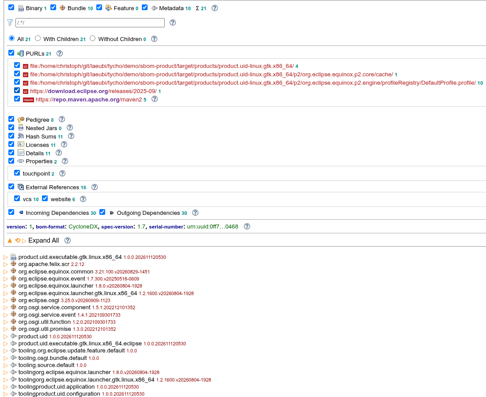

# SBOM for products

This demo shows how to create Software Bill of Materials (SBOM) for all products (and platform variants) of a project with a single `tycho-sbom-plugin:generator` execution.

The project contains one product (`simple.product`) with a few bundles (`org.eclipse.osgi`, `org.eclipse.equinox.common`, `org.apache.felix.scr`, `org.eclipse.equinox.event`).
The build does the following:
1. `tycho-p2-director-plugin:materialize-products` installs the product for each configured environment (linux and windows) to `target/products/<product uid>/<os>/<ws>/<arch>`
2. `tycho-p2-director-plugin:archive-products` packs each of them as an archive in `target/products`
3. `tycho-sbom-plugin:generator` (bound to `verify` by default) analyzes every archive found in `target/products` using the `installations` parameter

Run it with (the generator requires Java 25):

    mvn clean verify

`package` alone is not enough, as the generator runs in `verify`.

## Result

The following files are created in `target`:
- `product.uid-linux.gtk.x86_64-sbom.json` / `.xml` and `product.uid-win32.win32.x86_64-sbom.json` / `.xml` - the CycloneDX SBOM of each archive
- `index.html` - an overview page listing each SBOM with links to the raw files and to the [online renderer](https://download.eclipse.org/cbi/sbom/)

Each SBOM of this demo contains 21 components: the bundles of the product (including transitive ones like `org.osgi.service.component`), the launcher binary and p2 metadata entries (touchpoints, configuration), all with hashes, PURLs and dependencies.
Licenses, website and source repository links are included where the bundles provide them, e.g. `org.apache.felix.scr` is `Apache-2.0` and has the PURL `pkg:maven/org.apache.felix/org.apache.felix.scr@2.2.12`.

The execution enables:
- `centralsearch`: bundles available on Maven Central get a `pkg:maven` PURL, 5 of them in this demo
- `p2sources`: artifacts available in the given p2 repository reference it in their PURL

The remaining PURLs are `pkg:p2` with a local `file:` URL of the build, as these artifacts are not found in any of the configured sources.

The links to the renderer in `index.html` only work when the SBOMs are hosted on the same origin as the renderer (see [Viewing SBOMs](https://tycho.eclipseprojects.io/doc/latest/SBOM.html#viewing-sboms) for hosting it locally).
Alternatively open the [renderer](https://download.eclipse.org/cbi/sbom/), choose `SBOM Text` and paste the content of an `.xml` file:

Other parameters can be passed as properties, e.g. `-Dadvisory=true` or `-Dsbom.verbose=true`.

The mojo can also be called without a project on an existing installation or archive:

    mvn org.eclipse.tycho:tycho-sbom-plugin:generator -Dinstallation=<folder or archive> -Dprint.xml
